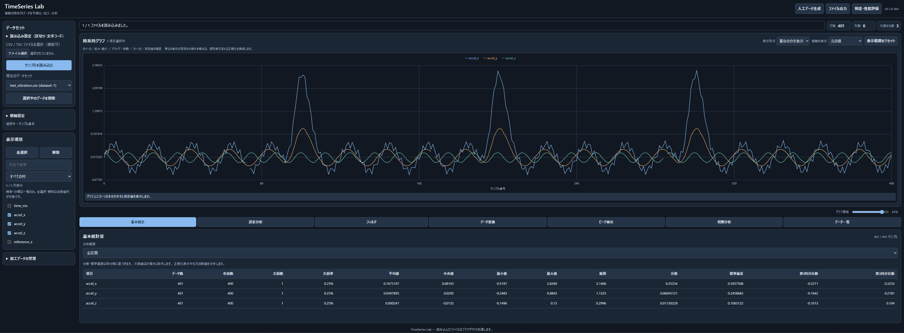
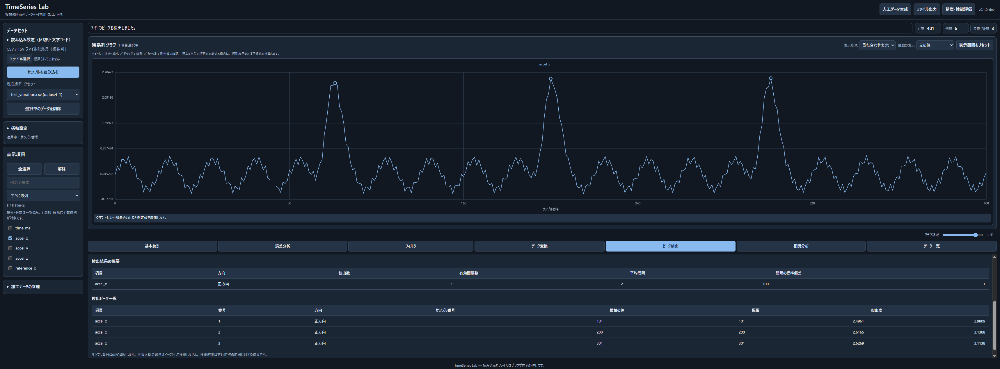
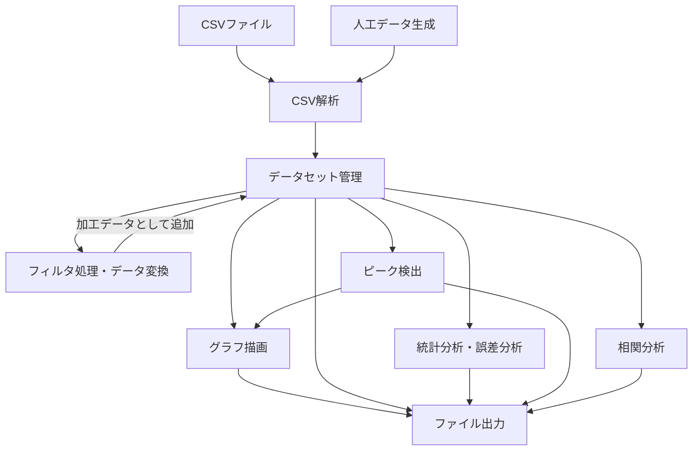

# TimeSeries Lab

ブラウザ上で動作する汎用時系列データ分析ツールです。

CSVファイルの読み込みから、可視化、統計分析、信号処理、
ピーク検出、相関分析、分析結果の出力までを一貫して行えます。

外部の実行時ライブラリやバックエンドを必要とせず、
データの分析処理はブラウザ内で完結します。

## 画面紹介

### 分析ワークスペース



### ピーク検出



## 主な機能

### データ管理

- CSV・TSVファイルの読み込み
- UTF-8・Shift_JISへの対応
- 複数データセットの管理
- 数値列・文字列・欠損値の判定
- 時刻列・サンプル番号による横軸設定
- 不等間隔サンプリングへの対応
- 元データと加工データの管理

### データの可視化

- 複数項目の重ね合わせ表示
- 項目ごとの個別グラフ表示
- Min-Max正規化表示
- マウスホイールによる拡大・縮小
- ドラッグによる表示範囲の移動
- カーソル位置の測定値表示
- ピーク検出位置のマーカー表示

### 統計分析

- 平均値・中央値
- 最大値・最小値・範囲
- 分散・標準偏差
- 四分位数
- 欠損数・欠損率
- 平均誤差・MAE・MSE・RMSE

### フィルタ処理

- 単純移動平均（SMA）
- 中央値フィルタ
- 指数移動平均（EMA）
- 窓幅・処理方向の指定

### データ変換・演算

- Nサンプル差分
- 実際の測定間隔を用いた時間微分
- 絶対値
- 定数との四則演算
- データ列同士の四則演算
- ベクトルの大きさ
- Min-Max正規化
- Z-score標準化

### ピーク検出

- 局所最大値・局所最小値の検出
- 振幅閾値の設定
- 項目別の振幅閾値設定
- Prominence（突出度）による検出
- 最小ピーク間隔の指定
- ピーク間隔の統計分析
- 平坦なピークへの対応

### 相関分析

- Pearson相関係数
- Spearman順位相関係数
- 相関行列・ヒートマップ
- 散布図
- 有効データ数の表示

### 人工データ生成

- 正弦波・矩形波・三角波
- 単発ピーク・周期ピーク
- 直線トレンド
- ランダムウォーク
- ガウスノイズ・一様ノイズ
- 欠損値・不等間隔サンプリングの生成
- 乱数シードによる再現
- ノイズ付加前の基準データ生成

### ファイル出力

- 元データ・加工データのCSV出力
- 統計分析結果のCSV出力
- ピーク検出結果のCSV出力
- 相関行列のCSV出力
- 時系列グラフのPNG出力
- 分析条件・加工履歴のJSON出力

## 使用技術

| 技術       | 用途                                 |
| ---------- | ------------------------------------ |
| HTML5      | 画面構成                             |
| CSS3       | レイアウト・レスポンシブデザイン     |
| JavaScript | データ解析・画面制御                 |
| Canvas API | 時系列グラフ描画                     |
| SVG        | 散布図描画                           |
| File API   | ローカルファイルの読み込み           |
| Blob API   | 分析結果のファイル出力               |
| Node.js    | 開発用サーバー・自動テスト・性能評価 |
| Git        | バージョン管理                       |

## 起動方法

### 必要な環境

- Node.js 22以上
- JavaScriptが有効なモダンブラウザ

### ローカルでの起動

プロジェクトのルートディレクトリで実行します。

```bash
npm start
```

ブラウザで以下のURLを開いてください。

http://127.0.0.1:5173/

外部パッケージのインストールは不要です。

## 基本的な使用方法

1. CSVファイルを読み込む
2. 横軸として使用する項目と単位を設定する
3. グラフに表示する項目を選択する
4. 分析タブから実行したい処理を選択する
5. 必要に応じて加工データを生成する
6. 分析結果をCSV・PNG・JSON形式で保存する

CSVを持っていない場合は、サンプルデータまたは
人工データ生成機能を利用できます。

## 対応するCSVの例

```csv
time_s,sensor_x,sensor_y,sensor_z
0.00,0.12,0.23,0.34
0.01,0.15,0.28,0.32
0.02,0.18,,0.30
0.03,0.21,0.31,0.28
```

列数や列名は固定されていません。
欠損値は空欄として扱います。

## システム構成

```text
TimeSeries-Lab/
├── index.html
├── package.json
├── README.md
├── css/
│   ├── style.css
│   └── ui.css
├── js/
│   ├── main.js
│   ├── ui.js
│   ├── csv.js
│   ├── dataset.js
│   ├── chart.js
│   ├── statistics.js
│   ├── filters.js
│   ├── transforms.js
│   ├── peaks.js
│   ├── correlation.js
│   ├── generator.js
│   ├── export.js
│   └── evaluation.js
├── samples/
├── scripts/
├── tests/
├── reports/
└── docs/
```

各分析処理を独立したモジュールとして管理し、
画面制御と数値計算の分離を図っています。

## データ処理の流れ



## 自動テスト

Node.js標準のテストランナーを使用しています。

```bash
npm test
```

CSV解析、データ管理、統計分析、フィルタ処理、
数値演算、ピーク検出、相関分析、人工データ生成、
ファイル出力などを対象にテストを実装しています。

正常な入力だけでなく、欠損値、不正な設定値、
定数データなどの境界条件についても検証しています。

## 精度・性能評価

人工データを用いた評価機能を実装しています。

### 精度評価

- フィルタ処理前後のMAE・RMSE
- 時間微分の理論値との比較
- ピーク検出のPrecision・Recall・F1-score
- 相関係数の理論値との比較

フィルタ処理の比較では、すべての手法で有効な
共通のサンプルを使用し、評価条件を統一しています。

### 処理性能

データ数や列数を変更した複数の条件で、
各分析処理の実行時間を測定します。

ウォームアップを1回行った後に5回計測し、
中央値・最小値・最大値を記録しています。

以下のコマンドから評価を実行できます。

```bash
node scripts/benchmark.js
```

評価結果は以下のファイルに出力されます。

- `reports/evaluation.json`
- `reports/benchmark.csv`

実行環境によって処理時間は異なります。

## プライバシー

読み込んだCSVファイルの解析・加工・描画は
ブラウザ内で行われます。

分析のためにデータを外部サーバーへ送信する処理は
実装していません。

なお、ブラウザを再読み込みすると、
読み込んだデータや加工結果は失われます。

## 現在の制約と今後の課題

- 大規模データの描画高速化
- ピーク検出アルゴリズムの計算効率改善
- Web Workerを利用した分析処理の非同期化
- 異なるデータセット間の比較分析
- FFTによる周波数分析
- 時間差を考慮した相互相関分析
- 分析条件や作業状態の保存・復元
- 異なる端末・ブラウザでの動作検証

## 参考資料

- [MDN Web Docs](https://developer.mozilla.org/)
- [Node.js Test Runner](https://nodejs.org/api/test.html)
- [RFC 4180: CSV File Format](https://www.rfc-editor.org/rfc/rfc4180)
- [SciPy Signal Processing](https://docs.scipy.org/doc/scipy/reference/signal.html)
- [SciPy Statistical Functions](https://docs.scipy.org/doc/scipy/reference/stats.html)
- [OWASP CSV Injection](https://owasp.org/www-community/attacks/CSV_Injection)
